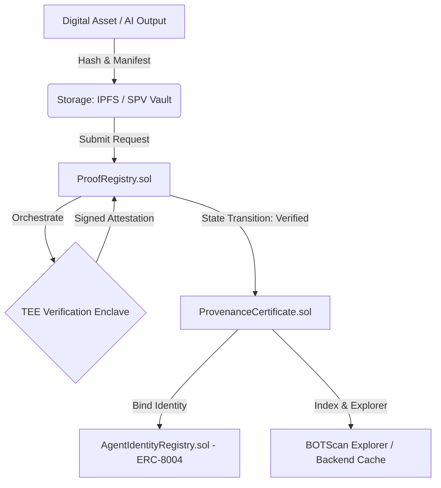

# 🤖 BOT Chain Proof — The Truth Engine for DePIN & AI

**BOT Chain Proof** (formerly StellarProof) is a decentralized provenance and digital content authenticity platform deployed natively on **BOT Chain** — the high-throughput, 100% EVM-compatible Layer 1 blockchain optimized for DePIN (Decentralized Physical Infrastructure Networks) and AI applications.

By migrating to BOT Chain, the platform leverages:
- **Proof of Staked Authority (PoSA)** consensus with ultra-fast **~0.75s block times** and **2-block deterministic finality**.
- Low and predictable transaction fees in native **BOT tokens** (~$0.06 avg fee).
- Built-in **Agent OS** integration supporting **ERC-8004 AI Agent Identity** and **ERC-4337 Agent Wallets**.
- Standard **Solidity smart contracts** (Hardhat, OpenZeppelin) and seamless EVM tooling (MetaMask, BO Wallet, ethers.js, viem).

BOT Chain Proof provides **Proof-as-a-Service APIs**, enabling AI agents, DePIN hardware devices, creators, and enterprise systems to anchor verifiable, tamper-proof provenance records on-chain.

---

## 🔑 Quick Summary

| Property | Value |
| :--- | :--- |
| **Project Name** | **BOT Chain Proof** |
| **Target Chain** | **BOT Chain** (Layer 1 EVM for DePIN & AI) |
| **Mainnet** | Chain ID `677` (`0x2a5`), RPC: `https://rpc.botchain.ai`, Explorer: `https://scan.botchain.ai` |
| **Testnet** | Bohr Testnet: Chain ID `968` (`0x3c8`), RPC: `https://rpc.bohr.life`, Explorer: `https://scan.bohr.life` |
| **Consensus & Speed** | PoSA, **~0.75s block time**, 2-block finality |
| **Native Gas Token** | `BOT` (Mainnet) / `tBOT` (Testnet) |
| **Smart Contracts** | Solidity (`^0.8.20`) via Hardhat |
| **Agent OS Support** | ERC-8004 (Agent Identity Registry) + ERC-4337 (Agent Wallet) |
| **Frontend** | Next.js (App Router) + TypeScript + Tailwind CSS + Ethers.js |
| **Backend** | Node.js + Express + TypeScript + MongoDB + Ethers.js |
| **Storage Layer** | IPFS (Decentralized) + MongoDB (High Performance Cache) |
| **Trusted Verification** | Oracle-driven TEE (Trusted Execution Environments) |
| **Monorepo Manager** | pnpm |

---

## 🌐 What BOT Chain Proof Solves

In the era of autonomous AI agents, deepfakes, and automated DePIN telemetry, proving content authenticity and machine identity is essential:

* **✅ Tamper-proof content provenance**: Anchors media and metadata hashes immutably to BOT Chain.
* **✅ AI Agent Provenance & Identity**: Integrates with BOT Chain's Agent OS and ERC-8004 to attribute generated content to registered autonomous agents.
* **✅ Cryptographic authenticity verification**: Combines confidential TEE attestation with on-chain cryptographic state machines.
* **✅ ERC-721 Provenance Certificates**: Mints non-fungible provenance tokens ensuring no manifest or content hash can be claimed twice.
* **✅ SPV (Secret Provenance Vault)**: Client-side KMS encryption with NFT-gated decryption policies on BOT Chain.
* **✅ High-speed, Low-cost Settlement**: Sub-second execution and micro-fees powered by PoSA consensus.

---

## 🚀 Core Architecture



---

## 🛠️ Smart Contracts (`contracts/`)

All smart contracts are developed with Solidity `^0.8.20` and tested using Hardhat and TypeScript:

### 1. `ProofRegistry.sol`
* **Purpose**: Core verification pipeline and oracle governance.
* **Features**:
  * Authorizes trusted Oracle providers (`authorizedProviders`).
  * Authorizes trusted TEE enclave measurement hashes (`authorizedTeeHashes`).
  * State guard machine: `Pending` → `Verified` or `Rejected`.
  * Verifies ECDSA signatures using `ecrecover` against attestation hashes.
  * Emits typed EVM events (`RequestSubmitted`, `RequestProcessed`, `ProviderAdded`, `TeeHashAdded`).

### 2. `ProvenanceCertificate.sol`
* **Purpose**: ERC-721 provenance NFT contract.
* **Features**:
  * Mints unique non-fungible certificates with on-chain metadata pointers.
  * Prevents duplicate certificate generation for the same content hash.
  * Supports operator roles and certificate revocation.

### 3. `AgentIdentityRegistry.sol`
* **Purpose**: BOT Chain Agent OS & ERC-8004 identity binding.
* **Features**:
  * Registers AI agent identities with assigned types (`crawler`, `trader`, `verifier`, etc.).
  * Binds minted provenance certificates directly to registered AI agents.

---

## 🧭 Network Configuration & RPCs

### BOT Chain Mainnet
* **Network Name**: BOT Chain Mainnet
* **Chain ID**: `677` (`0x2a5` hex)
* **Currency Symbol**: `BOT` (18 decimals)
* **RPC URL**: `https://rpc.botchain.ai`
* **Block Explorer**: [https://scan.botchain.ai](https://scan.botchain.ai)

### Bohr Testnet
* **Network Name**: Bohr Testnet
* **Chain ID**: `968` (`0x3c8` hex)
* **Currency Symbol**: `tBOT` (18 decimals)
* **RPC URL**: `https://rpc.bohr.life`
* **Block Explorer**: [https://scan.bohr.life](https://scan.bohr.life)

---

## 🏗️ Project Structure

```text
StellarProof/
├── contracts/                  # Solidity smart contracts (Hardhat)
│   ├── contracts/
│   │   ├── interfaces/         # IProofRegistry.sol, IProvenanceCertificate.sol
│   │   ├── ProofRegistry.sol   # Core verification state machine
│   │   ├── ProvenanceCertificate.sol # ERC-721 provenance NFT
│   │   └── AgentIdentityRegistry.sol # ERC-8004 Agent OS identity
│   ├── scripts/deploy.ts       # Deployment script for BOT Chain
│   ├── test/                   # Hardhat test suite
│   └── hardhat.config.ts       # Network config (Mainnet 677, Bohr 968)
│
├── frontend/                   # Next.js web application
│   ├── config/network.ts       # BOT Chain network definitions & helpers
│   ├── context/WalletContext.tsx # EVM wallet connection & chain switching
│   ├── services/wallet.ts      # MetaMask / BO Wallet integration
│   ├── services/transactionService.ts # BOT Chain JSON-RPC polling
│   ├── components/wallet/      # NetworkBadge, AccountDropdown, WrongNetworkWarning
│   └── features/verification/  # Multi-step verification wizard
│
├── backend/                    # Express + MongoDB API service
│   ├── src/config/env.ts       # BOT Chain RPC and contract environment config
│   ├── src/services/spv.service.ts # NFT balance checking on BOT Chain
│   ├── src/services/certificate.service.ts # Certificate cache management
│   ├── src/services/verification.service.ts # Job state transitions
│   └── src/controllers/        # REST API endpoints
│
└── docs/                       # Architecture & event specifications
    ├── verification_pipeline.md# Verification workflow on BOT Chain
    └── registry_events.md      # Solidity event topic schemas
```

## 📄 Protocol Whitepaper
The detailed scientific and architectural specification of the Proofiy Protocol is published in:
* **Online Reader**: [proofiy.vercel.app/whitepaper](https://proofiy.vercel.app/whitepaper)
* **Whitepaper Source**: [`docs/WHITEPAPER.md`](./docs/WHITEPAPER.md)

Key whitepaper topics include:
* Confidential TEE Hardware Attestation (AWS Nitro Enclaves PCR0/1/2 validation)
* ERC-8004 AI Agent Identity Registry & Reputation Binding
* Formal Cryptographic Hashing and Non-Fungible Provenance Certificates (`BOTCERT`)
* BOT Chain PoSA Consensus, Gas Rebate Mechanics & Sybil Defense Models

---

## ⛓️ Live On-Chain Verification (6 Verified Bohr Testnet Transactions)

Proofiy has executed and verified the complete end-to-end provenance lifecycle directly on **Bohr Testnet** (Chain ID `968`).

* **Deployer Account**: [`0xA4A42E4873d57Dd91fA9D41D5956EA51E4D69DE9`](https://scan.bohr.life/address/0xA4A42E4873d57Dd91fA9D41D5956EA51E4D69DE9)
* **ProvenanceCertificate**: [`0x1f572428708e3eEB0e56277972bdFFe010Cb3A9B`](https://scan.bohr.life/address/0x1f572428708e3eEB0e56277972bdFFe010Cb3A9B)
* **ProofRegistry**: [`0xB766F0Ad04132b109577b31bF4a63b6462f40261`](https://scan.bohr.life/address/0xB766F0Ad04132b109577b31bF4a63b6462f40261)
* **AgentIdentityRegistry (ERC-8004)**: [`0x6f3922EF9BcfEB1fBb3c157b1F8947b70c59d773`](https://scan.bohr.life/address/0x6f3922EF9BcfEB1fBb3c157b1F8947b70c59d773)

### On-Chain Transaction Records:
| # | Action / Operation | Block | Transaction Hash | Gas Used | Status |
|---|--------------------|-------|------------------|----------|--------|
| **1** | **Authorize AWS Nitro Enclave PCR0 Hash** | `26916498` | [`0x9482db7b...1100d`](https://scan.bohr.life/tx/0x9482db7b2f7572dad3d3573c571191641e4abe055a7b3ba7215823770d61100d) | 116,910 | **Confirmed** |
| **2** | **Whitelist Authorized Oracle Node Provider** | `26916502` | [`0xbaa9940f...5673e`](https://scan.bohr.life/tx/0xbaa9940ff513f8bb9b3a950ce42d2e398bc4b90669633b9cd372b7bcc5f5673e) | 47,547 | **Confirmed** |
| **3** | **Register ERC-8004 Autonomous AI Agent** | `26916507` | [`0x602ee2cb...f3979`](https://scan.bohr.life/tx/0x602ee2cbdc5ad01f514944e356e0a3b78baced589cb6c300af52c94d579f3979) | 272,126 | **Confirmed** |
| **4** | **Create Content Verification Request** | `26916511` | [`0xdda31aff...94db0`](https://scan.bohr.life/tx/0xdda31affbaa6db08c14cbfee2c9da1d6909e9653cf53a3f257a7a47d0c594db0) | 140,319 | **Confirmed** |
| **5** | **Mint ERC-721 Provenance Certificate** (`BOTCERT #1`) | `26916516` | [`0x8fe68266...5075b`](https://scan.bohr.life/tx/0x8fe6826681fa31510650e612bba5f3ed4cf7fe8938ed2f1da953be94a6a5075b) | 281,194 | **Confirmed** |
| **6** | **Bind Certificate #1 to ERC-8004 Agent #1** | `26916521` | [`0x1f0157bf...df4a61`](https://scan.bohr.life/tx/0x1f0157bfdf6498d5310bf50549d74301cd927b539cf348a2afa6e238fbdf4a61) | 71,853 | **Confirmed** |

---

## ⚡ Getting Started

### Prerequisites
* **Node.js**: v20 or higher (v24 LTS recommended)
* **pnpm**: v9 or higher
* **EVM Wallet**: MetaMask or BO Wallet (Bohr Wallet)

### 1. Install Dependencies
```bash
pnpm install
```

### 2. Compile & Test Smart Contracts
```bash
pnpm build:contracts
pnpm test:contracts
```

To deploy contracts to Bohr Testnet:
```bash
cd contracts
npx hardhat run scripts/deploy.ts --network bohrTestnet
```

### 3. Run Backend Server
```bash
cd backend
cp .env.example .env
pnpm dev
```

### 4. Run Frontend
```bash
cd frontend
pnpm dev
```
Open [http://localhost:3000](http://localhost:3000) to access the BOT Chain Proof web app.

---

## 🤝 Wallet Support

BOT Chain Proof supports all standard EVM wallets:
- **MetaMask**: Browser extension & Mobile. Automatic network addition for BOT Chain (`wallet_addEthereumChain`).
- **BO Wallet**: Native BOT Chain ecosystem wallet ([https://wallet.bohr.life/](https://wallet.bohr.life/)).
- **Agent Wallet**: ERC-4337 smart accounts via BOT Chain Agent OS (`wallet-api.botchain.ai`).

---

## 📄 License

MIT License
