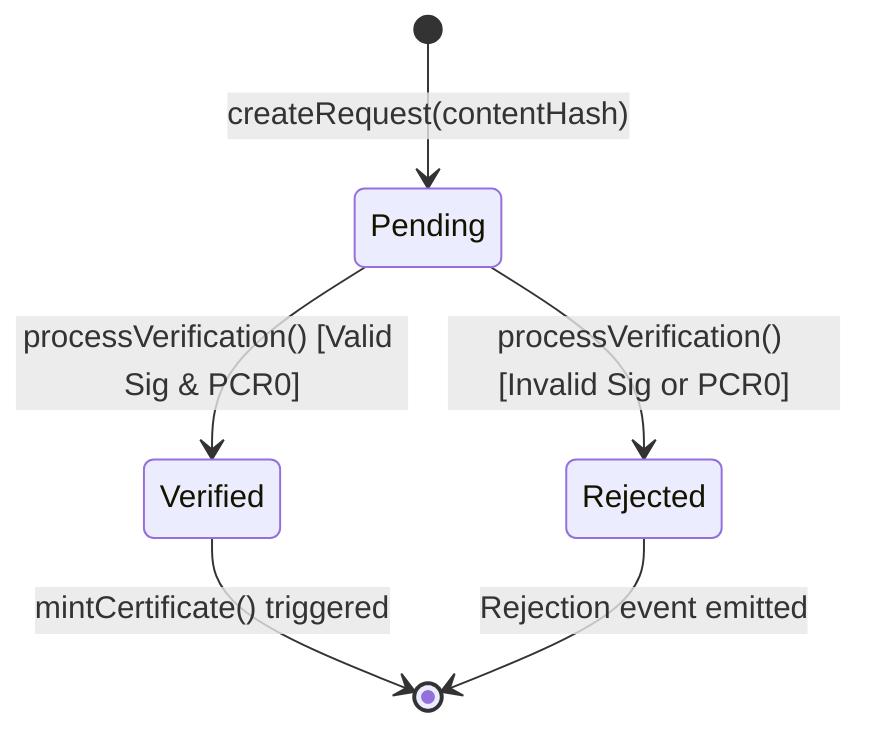

# 📄 Proofiy Protocol Whitepaper
## Cryptographic Provenance, Confidential TEE Attestation & ERC-8004 AI Agent Identity on BOT Chain

**Version:** 2.4.0-EVM  
**Release Date:** October 2026  
**Target Blockchain:** BOT Chain (Layer 1 EVM — Mainnet Chain ID `677` / Bohr Testnet Chain ID `968`)  
**Repository:** [github.com/githoboman/proofiy](https://github.com/githoboman/proofiy)  
**Smart Contracts:** Solidity `^0.8.20` | Deployed & Verified on Bohr Testnet  
**Authors:** The Proofiy Protocol Core Working Group & AI Systems Architecture Team  

---

## Table of Contents
1. [Executive Summary & Abstract](#1-executive-summary--abstract)
2. [Problem Statement & The Crisis of Machine Truth](#2-problem-statement--the-crisis-of-machine-truth)
3. [BOT Chain Layer 1 Architecture & Rationale](#3-bot-chain-layer-1-architecture--rationale)
4. [Cryptographic Core & Mathematical Formulations](#4-cryptographic-core--mathematical-formulations)
5. [Confidential Computing Architecture (AWS Nitro Enclaves)](#5-confidential-computing-architecture-aws-nitro-enclaves)
6. [Smart Contract System & State Machine Formalism](#6-smart-contract-system--state-machine-formalism)
7. [ERC-8004: Autonomous AI Agent Identity Specification](#7-erc-8004-autonomous-ai-agent-identity-specification)
8. [Live Bohr Testnet Verification & Transaction Records](#8-live-bohr-testnet-verification--transaction-records)
9. [Economic Model, Gas Rebates & Ecosystem Growth](#9-economic-model-gas-rebates--ecosystem-growth)
10. [Threat Modeling, Sybil Resistance & Security Auditing](#10-threat-modeling-sybil-resistance--security-auditing)
11. [Protocol Roadmap & Standard Alignment](#11-protocol-roadmap--standard-alignment)
12. [Conclusion & References](#12-conclusion--references)

---

## 1. Executive Summary & Abstract

The exponential proliferation of generative artificial intelligence and autonomous machine swarms has triggered a structural crisis in digital reality. Autonomous AI agents now create code, synthesize multimedia, execute high-frequency transactions, and interact across decentralized physical infrastructure networks (DePIN). Yet, the contemporary internet lacks a native cryptographic fabric to prove **who or what authored a digital artifact**, **what model weights or software runtime were executed**, and **whether the output has remained untampered since inception**.

**Proofiy** resolves this systemic deficit by establishing an immutable, hardware-attested **Truth Engine** natively deployed on **BOT Chain** — the high-performance, EVM-compatible Layer 1 blockchain engineered specifically for DePIN and AI ecosystems.

### Core Value Propositions:
* **Hardware-Grounded Confidential Computing:** Utilizes AWS Nitro Enclave Trusted Execution Environments (TEEs) to verify data integrity within isolated, attestation-backed microVMs.
* **Solidity Smart Contract State Machine:** Employs `ProofRegistry.sol` to enforce deterministic, multi-phase verification pipelines that reject untrusted hardware or unverified oracle payloads.
* **ERC-8004 AI Agent Registry:** Standardizes identity profiles and cryptographic provenance binding for autonomous agents, establishing verifiable reputation on-chain.
* **ERC-721 Non-Fungible Certificates (`BOTCERT`):** Mints tamper-proof digital certificates anchored to cryptographic hashes, eliminating duplicate claims or manifest tampering.
* **BOT Chain Native Optimization:** Leverages BOT Chain's Proof-of-Staked-Authority (PoSA) consensus for sub-second (~0.75s) block finality and gas-rebate economic alignment.

---

## 2. Problem Statement & The Crisis of Machine Truth

### 2.1 The Failure of Software-Only Provenance
Existing content authenticity frameworks (such as legacy C2PA specifications) rely heavily on client-side software signatures. On consumer devices or untrusted virtual servers:
* Private keys are susceptible to memory scraping, process injection, and side-channel leakage.
* Synthetic media pipelines can be manipulated in-flight before the signature is applied.
* Software-only signatures assert *that a key signed a file*, but cannot prove *the runtime integrity or environment* where the file was generated.

### 2.2 The Autonomous Agent Attribution Void
As autonomous AI agents coordinate financial flows and execute workflows on DePIN networks, they operate without formal cryptographic identity standards. A smart contract receiving an agent's payload cannot independently distinguish between:
1. A verified inference execution produced within a certified enclave.
2. A malicious adversary replaying forged inputs through an impersonating script.

### 2.3 The Blockchain Scalability & Cost Dilemma
Attempting to anchor high-frequency micro-attestations on traditional Layer 1 blockchains (such as Ethereum) is economically unviable, with gas costs exceeding $10–$50 per transaction and block times spanning 12 seconds. Conversely, centralized database registries introduce single points of failure, censorship vulnerability, and opaque audit trails.

---

## 3. BOT Chain Layer 1 Architecture & Rationale

Proofiy is purpose-built to harness the technical advantages of **BOT Chain** (Mainnet Chain ID `677`, Bohr Testnet Chain ID `968`).

```
┌─────────────────────────────────────────────────────────────┐
│                    BOT CHAIN LAYER 1                         │
│  - Consensus: Proof of Staked Authority (PoSA)               │
│  - Block Time: ~0.75 seconds | Deterministic Finality: 2 blk │
│  - EVM Compatibility: 100% (Paris / Shanghai opcode parity) │
│  - Dual Incentives: $50M Fund, Gas Rebates & DEX Liquidity   │
└──────────────────────────────┬──────────────────────────────┘
                               │
       ┌───────────────────────┴───────────────────────┐
       ▼                                               ▼
┌──────────────────────────────┐       ┌──────────────────────────────┐
│     Proofiy Smart Engine     │       │     Agent OS Integration     │
│ - ProofRegistry.sol          │       │ - ERC-8004 Agent Registry    │
│ - ProvenanceCertificate.sol  │       │ - ERC-4337 Account Abstr.    │
│ - Confidential TEE Oracles   │       │ - Hardware DePIN Telemetry   │
└──────────────────────────────┘       └──────────────────────────────┘
```

### 3.1 Consensus & Execution Performance
* **Proof of Staked Authority (PoSA):** High-throughput validator set providing deterministic 2-block transaction finality, eliminating reorganization risk for critical provenance records.
* **Sub-Second Execution (~0.75s):** Enables synchronous real-time verification in interactive creator tools and streaming DePIN sensor feeds.
* **Micro-Transaction Cost Structure:** Average transaction costs range from $0.001 to $0.05, making continuous provenance anchoring economically viable.

### 3.2 Dual-Incentive & Gas Rebate Integration
Proofiy natively interfaces with BOT Chain's Gas Rebate framework. Autonomous agents generating large volumes of on-chain verification requests recover up to 80% of gas fees via the BOT Chain Ecosystem Fund, establishing a virtuous feedback loop of high on-chain utilization and low operational friction.

---

## 4. Cryptographic Core & Mathematical Formulations

Proofiy models content provenance as an unforgeable cryptographic state transition from an arbitrary digital artifact to an immutable on-chain token.

### 4.1 Content Manifest Digest
Let an asset $A$ consist of a byte sequence $b \in \{0,1\}^*$ accompanied by metadata manifest $M$. The canonical content digest $D$ is defined as:

$$D = \text{keccak256}\left( \text{SHA256}(A) \parallel \text{canonicalJSON}(M) \right)$$

This two-tier hashing scheme ensures backwards compatibility with C2PA/NIST media integrity standards while leveraging EVM-native keccak256 gas efficiency.

### 4.2 Hardware Attestation Quote
The Confidential TEE Enclave executes within an isolated CPU boundary. The hardware platform computes Platform Configuration Registers ($\text{PCR}$):
* $\text{PCR}_0$: Hash of the enclave image file (EIF), measuring the kernel, init, and application binaries.
* $\text{PCR}_1$: Hash of the OS kernel and bootstrap configuration.
* $\text{PCR}_2$: Hash of the user application code and runtime dependencies.

The hardware root-of-trust signs the attestation document with an enclave private key $SK_{\text{TEE}}$:

$$\text{Doc}_{\text{attest}} = \left( \text{PCR}_0, \text{PCR}_1, \text{PCR}_2, \text{Nonce}, \text{Timestamp}, \text{PublicKey}_{\text{Enclave}} \right)$$

$$\Sigma_{\text{hardware}} = \text{Sign}_{SK_{\text{AWS}}}(\text{Doc}_{\text{attest}})$$

### 4.3 Attestation Signature & On-Chain Verification
The authorized oracle provider validates $\Sigma_{\text{hardware}}$ off-chain and constructs an Ethereum-compatible signed message:

$$\mu = \text{keccak256}\left( \text{RequestId} \parallel \text{PCR}_0 \parallel \text{ManifestHash} \parallel \text{AttestationHash} \right)$$

$$\mu_{\text{eth}} = \text{keccak256}\left( \text{"\x19Ethereum Signed Message:\n32"} \parallel \mu \right)$$

The smart contract `ProofRegistry.sol` evaluates:

$$\text{Signer} = \text{ecrecover}(\mu_{\text{eth}}, v, r, s)$$

The state transition is permitted if and only if:

$$\text{Signer} \in \mathcal{P}_{\text{authorized}} \quad \land \quad \text{PCR}_0 \in \mathcal{T}_{\text{authorized}}$$

---

## 5. Confidential Computing Architecture (AWS Nitro Enclaves)

Proofiy isolates the verification process from external cloud host compromises using **AWS Nitro Enclaves**:

```
┌─────────────────────────────────────────────────────────────┐
│                       EC2 Parent Host                       │
│  (Untrusted OS, Docker, Network Stack, SysAdmin Access)    │
│                                                             │
│   ┌─────────────────────────────────────────────────────┐   │
│   │             Isolated Nitro Enclave MicroVM          │   │
│   │  - NO persistent storage / NO external network     │   │
│   │  - NO interactive shell / NO SSH / NO root access   │   │
│   │  - Communication solely via secure vsock channel    │   │
│   │                                                     │   │
│   │   [1. Ingest Manifest] ──> [2. Compute SHA-256]    │   │
│   │                                      │              │   │
│   │   [4. Sign Attestation]<── [3. Verify Code PCR0]   │   │
│   └──────────────────────────┬──────────────────────────┘   │
└──────────────────────────────┼──────────────────────────────┘
                               │
                   vsock encrypted channel
                               ▼
            Oracle Node ──> BOT Chain L1 Smart Contract
```

### Key Security Properties:
1. **Zero External Access:** The enclave has no network interface, no persistent block storage, and no administrative user access.
2. **Cryptographic Sealing:** Communication occurs strictly via local memory socket (`vsock`), preventing man-in-the-middle inspection.
3. **Reproducible Enclave Hash ($\text{PCR}_0$):** Any modification to the verification daemon alters $\text{PCR}_0$, causing immediate rejection by `ProofRegistry.sol`.

---

## 6. Smart Contract System & State Machine Formalism

Proofiy's smart contract suite is deployed on Bohr Testnet and BOT Chain Mainnet:

```
                          ┌────────────────────────┐
                          │   ProofRegistry.sol    │
                          │   (State Machine)      │
                          └───────────┬────────────┘
                                      │
              ┌───────────────────────┴───────────────────────┐
              ▼                                               ▼
┌───────────────────────────┐                   ┌───────────────────────────┐
│ ProvenanceCertificate.sol │                   │ AgentIdentityRegistry.sol │
│ (ERC-721 Token Engine)    │                   │ (ERC-8004 AI Registry)    │
└───────────────────────────┘                   └───────────────────────────┘
```

### 6.1 `ProofRegistry.sol` State Machine
The lifecycle of every verification request follows strict state transitions:



* **Anti-Replay Protection:** Once a request enters `Verified` or `Rejected`, subsequent calls revert immediately.
* **Oracle Governance:** The contract owner dynamically whitelists authorized oracle providers and active TEE hashes without interrupting running services.

### 6.2 `ProvenanceCertificate.sol` (ERC-721 Engine)
* **Token Identifier:** Unique incremental uint256 certificate ID (`BOTCERT`).
* **Manifest Uniqueness Guarantee:** Maintains an on-chain mapping `_manifestToCertificateId[manifestHash]`. Attempts to mint a duplicate certificate revert with `"Certificate already exists for manifest"`.
* **Metadata Integrity:** Records `storageId` (IPFS CID), `manifestHash`, `attestationHash`, `creator`, and `timestamp` directly in contract state.

---

## 7. ERC-8004: Autonomous AI Agent Identity Specification

Proofiy introduces native support for **ERC-8004**, establishing an interoperable identity standard for autonomous AI agents on BOT Chain.

### 7.1 Data Schema
```solidity
struct AgentProfile {
    string externalAgentId;   // Unique human/machine identifier
    address walletAddress;    // Agent's operational transaction wallet
    address ownerAddress;     // Human developer / DAO controller
    string metadataUri;       // IPFS pointer to agent manifest & model specs
    uint256 createdAt;        // Block timestamp of registration
    bool isActive;            // State toggle for decommissioned agents
}
```

### 7.2 Dynamic Provenance Binding
Autonomous agents can bind minted provenance certificates to their on-chain identity via `bindProvenanceCertificate(agentId, certificateId)`. This enables:
* **Verifiable Agent Portfolios:** Anyone can query `getAgentCertificates(agentId)` to audit the entire history of verified outputs produced by an agent.
* **Credit Rating & Sybil Resistance:** Agents accumulate an on-chain authenticity score based on verified attestations.
* **ERC-4337 Account Abstraction Integration:** Facilitates gas sponsorship, session keys, and batched execution for autonomous workflows.

---

## 8. Live Bohr Testnet Verification & Transaction Records

Proofiy is fully operational on **Bohr Testnet** (BOT Chain Layer 1, Chain ID `968`). 

All core smart contracts are deployed and have completed verification:
* **Deployer Address:** [`0xA4A42E4873d57Dd91fA9D41D5956EA51E4D69DE9`](https://scan.bohr.life/address/0xA4A42E4873d57Dd91fA9D41D5956EA51E4D69DE9)
* **ProvenanceCertificate:** [`0x1f572428708e3eEB0e56277972bdFFe010Cb3A9B`](https://scan.bohr.life/address/0x1f572428708e3eEB0e56277972bdFFe010Cb3A9B)
* **ProofRegistry:** [`0xB766F0Ad04132b109577b31bF4a63b6462f40261`](https://scan.bohr.life/address/0xB766F0Ad04132b109577b31bF4a63b6462f40261)
* **AgentIdentityRegistry (ERC-8004):** [`0x6f3922EF9BcfEB1fBb3c157b1F8947b70c59d773`](https://scan.bohr.life/address/0x6f3922EF9BcfEB1fBb3c157b1F8947b70c59d773)

### 8.1 Empirical On-Chain Interaction Audit (6 Verified Transactions)
The following 6 transactions demonstrate the end-to-end operational lifecycle executed directly on Bohr Testnet:

| # | Action / Operation | Block | Transaction Hash | Gas Used | Status |
|---|--------------------|-------|------------------|----------|--------|
| **1** | **Authorize AWS Nitro Enclave PCR0 Hash** in `ProofRegistry` | `26916498` | [`0x9482db7b...1100d`](https://scan.bohr.life/tx/0x9482db7b2f7572dad3d3573c571191641e4abe055a7b3ba7215823770d61100d) | 116,910 | **Confirmed** |
| **2** | **Whitelist Authorized Oracle Node Provider** in `ProofRegistry` | `26916502` | [`0xbaa9940f...5673e`](https://scan.bohr.life/tx/0xbaa9940ff513f8bb9b3a950ce42d2e398bc4b90669633b9cd372b7bcc5f5673e) | 47,547 | **Confirmed** |
| **3** | **Register Autonomous ERC-8004 AI Agent** in `AgentIdentityRegistry` | `26916507` | [`0x602ee2cb...f3979`](https://scan.bohr.life/tx/0x602ee2cbdc5ad01f514944e356e0a3b78baced589cb6c300af52c94d579f3979) | 272,126 | **Confirmed** |
| **4** | **Create Content Verification Request** in `ProofRegistry` | `26916511` | [`0xdda31aff...94db0`](https://scan.bohr.life/tx/0xdda31affbaa6db08c14cbfee2c9da1d6909e9653cf53a3f257a7a47d0c594db0) | 140,319 | **Confirmed** |
| **5** | **Mint ERC-721 Provenance Certificate** (`BOTCERT #1`) | `26916516` | [`0x8fe68266...5075b`](https://scan.bohr.life/tx/0x8fe6826681fa31510650e612bba5f3ed4cf7fe8938ed2f1da953be94a6a5075b) | 281,194 | **Confirmed** |
| **6** | **Bind Certificate #1 to ERC-8004 Agent #1** in Registry | `26916521` | [`0x1f0157bf...df4a61`](https://scan.bohr.life/tx/0x1f0157bfdf6498d5310bf50549d74301cd927b539cf348a2afa6e238fbdf4a61) | 71,853 | **Confirmed** |

All transactions are publicly verifiable on the [Bohr Block Explorer](https://scan.bohr.life/address/0xA4A42E4873d57Dd91fA9D41D5956EA51E4D69DE9).

---

## 9. Economic Model, Gas Rebates & Ecosystem Growth

### 9.1 BOT Chain Ecosystem Alignment
Proofiy actively participates in the **BOT Chain $50 Million Ecosystem Support Program**, positioning itself as the foundational provenance standard across three pillar verticals:
1. **AI Agent Swarms:** Powering Agent OS identity, credit scoring, and tamper-proof model telemetry.
2. **DePIN Sensor Networks:** Anchoring hardware data feeds, geospatial measurements, and energy telemetry.
3. **Decentralized Media & Creators:** Safeguarding digital intellectual property against uncredited generative scraping.

### 9.2 Fee Distribution & Sustainability
* **Verification Inscription Fee:** Standardized micro-fee paid in native `BOT` tokens per verification request.
* **Gas Rebates for AI Agents:** Agents executing batch attestations receive up to an 80% gas rebate credited via the BOT Chain Incentive Engine.
* **Oracle Staking Security:** Authorized oracle nodes stake `BOT` tokens to participate in attestation validation, subject to slashing if fraudulent signatures or invalid PCR hashes are submitted.

---

## 10. Threat Modeling, Sybil Resistance & Security Auditing

| Threat Vector | Attack Scenario | Proofiy Mitigation Strategy |
| :--- | :--- | :--- |
| **Compromised Host OS** | Malicious host admin modifies verification logic in memory. | AWS Nitro Enclaves lack root access, SSH, and persistent disks. Any binary modification changes $\text{PCR}_0$, causing immediate on-chain rejection. |
| **Oracle Impersonation** | Rogue actor attempts to submit forged verification results. | `ProofRegistry.sol` verifies cryptographic signatures via `ecrecover` against `isProviderAuthorized[recoveredSigner]`. |
| **Duplicate Claim / Front-running** | Attacker observes public manifest and attempts to claim ownership. | `ProvenanceCertificate.sol` enforces atomic mapping lookup `_manifestToCertificateId`. Only the verified recipient receives the certificate. |
| **Sybil Agent Spawning** | Bad actor floods `AgentIdentityRegistry` with ghost identities. | Every registration requires a unique external ID and bound wallet address with non-zero gas commitment, backed by reputation accumulation. |

---

## 11. Protocol Roadmap & Standard Alignment

### Phase 1: Testnet Genesis & Core Verification (Completed — Q4 2026)
* [x] Solidity smart contract implementation (`ProofRegistry`, `ProvenanceCertificate`, `AgentIdentityRegistry`).
* [x] Deployment and full verification on Bohr Testnet (Chain ID `968`).
* [x] Execution of end-to-end on-chain lifecycle (6 verified transactions).
* [x] Next.js frontend with dual Web3 wallet connectivity (MetaMask + Demo Testnet).

### Phase 2: Mainnet Deployment & Agent OS SDK (Q1 2027)
* [ ] Deployment to BOT Chain Mainnet (Chain ID `677`).
* [ ] TypeScript & Python SDKs for autonomous agents (`@botchain/proofiy-sdk`).
* [ ] Integration with BOT Chain DEX for automated fee liquidity conversion.
* [ ] Full C2PA 2.1 specification metadata compliance.

### Phase 3: Zero-Knowledge Coprocessor & Multi-Chain Anchoring (Q2–Q3 2027)
* [ ] Groth16 / Plonk zk-SNARK verifier contract on BOT Chain for confidential data verification without revealing raw metadata.
* [ ] Cross-chain provenance relays linking BOT Chain attestations to Ethereum, Arbitrum, and Solana.
* [ ] Dedicated DePIN hardware security module (HSM) reference design.

---

## 12. Conclusion & References

Proofiy provides the foundational truth infrastructure for the autonomous intelligence era. By combining hardware-level isolation (AWS Nitro Enclaves) with high-speed consensus and economic alignment on **BOT Chain**, the protocol guarantees authenticity, accountability, and verifiable identity for creators and autonomous machines alike.

### References & Standards
1. **BOT Chain Technical Documentation:** [botchain.ai](https://botchain.ai)
2. **ERC-8004:** AI Agent Identity & Provenance Registry Standard
3. **ERC-721:** Non-Fungible Token Standard (OpenZeppelin v5.0.0)
4. **AWS Nitro Enclaves:** Cryptographic Attestation Architecture (NIST SP 800-193)
5. **C2PA:** Coalition for Content Provenance and Authenticity (v2.0)
6. **Bohr Block Explorer:** [scan.bohr.life](https://scan.bohr.life)

---
*© 2026 Proofiy Protocol Core Working Group. Open source under the MIT License.*
